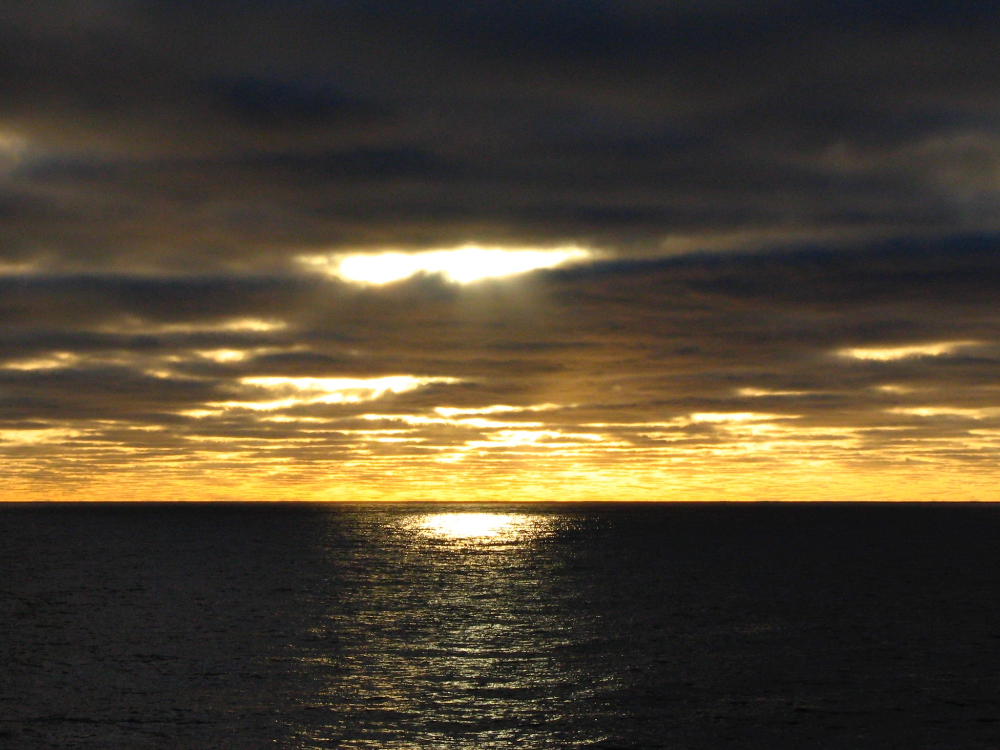

```{r message=FALSE, warning=FALSE}

library(tidyverse)
library(forcats)
library(kableExtra)
library(plotly)

portal_rodent <- read.csv("https://github.com/weecology/PortalData/raw/main/Rodents/Portal_rodent.csv")

data("mpg")

```

## Tables

Tables are made by adding a label that starts with "tbl-"

```{r}
#| label: tbl-mpg-table
#| tbl-cap: "A table showing manufacturer counts."  

mpg_table <- mpg |>
  mutate(man_fac = manufacturer |> as.factor()) |>
  mutate(man_fac = man_fac |> fct_lump_prop(0.1)) |>
  count(man_fac) |>
  kbl(col.names = c("Manufacturer", "Count")) |>
  kable_styling()

mpg_table

```

The label after "tbl-" is totally made up and you can pick something that makes sense for you. In this case I chose `mpg-table`. To reference this table in the text just write `@tbl-mpg-table`. This will automatically create a numbered and linked in-line citation.

Here is an example of a numbered and linked in-line citation for @tbl-mpg-table.

Table labels and captions will automatically display above tables (standard in scientific publication for tables). Remember that you can manipulate the styling of your table using the kableExtra package.

## Figures

Figures are made by adding a label that starts with "fig-"

```{r}
#| label: fig-lineplot
#| fig-cap: "A plotly lineplot showing rodent trapping counts over time."  

portal_rodent_mod <- portal_rodent |>
  mutate(date=make_date(year, month, day))

linegraph <- portal_rodent_mod |>
  mutate(month_floor = floor_date(date, "month")) |>
  count(month_floor) |>
  ggplot() +
  geom_line(aes(x=month_floor, y=n)) +
  xlab("Time") +
  ylab("Count)") +
  theme_minimal()

ggplotly(linegraph) |>
  layout(xaxis = list(rangeslider = list(visible = TRUE)))

```

The label after "fig-" is totally made up and you can pick something that makes sense for you. In this case, I chose "lineplot". To reference this figure in the text just write `@fig-lineplot` like so @fig-lineplot. This will automatically create a numbered and linked in-line citation. Figures labels and captions will automatically display below figures (standard in scientific publication for figures).

What if I want to make subfigures?

```{r}
#| label: fig-plots 
#| fig-cap: "Plots"  
#| fig-subcap: 
#| - "Plot 1" 
#| - "Plot 2"  
#| layout-ncol: 2 


linegraph 

bar_plot <- portal_rodent_mod |>
  mutate(wday=wday(date, label=TRUE)) |>
  count(wday) |>
  ggplot() +
  geom_col(aes(x=wday, y=n, fill=wday)) +
  theme_minimal()

bar_plot

```

Calling @fig-plots will reference both figures at once Calling @fig-plots-2 will reference only the second subfigure.

## Images

What about if I want an image or .gif to be a figure? Two options:

You can just add figure label to the end of your image. This is the simplest/easiest approach if you have one image.

{#fig-sun1}

This first option, obnoxiously, only works if you use relative file paths and you will need to deal with the roking directory issues that Quarto creates. 

I prefer the second option where you call the image inside a R chunk. This is particularly useful if you want to have subfigures, etc.

```{r}
#| label: fig-sun2
#| fig-cap: "An image of the sun shining through the clouds in the Southern Ocean."
knitr::include_graphics("/Users/caseysmith/Desktop/NBP_midnight_sun.jpeg")
```

To get this code to render on your computer you will need to put in your own image in here. You will need to replace the existing @fig-sun2.
